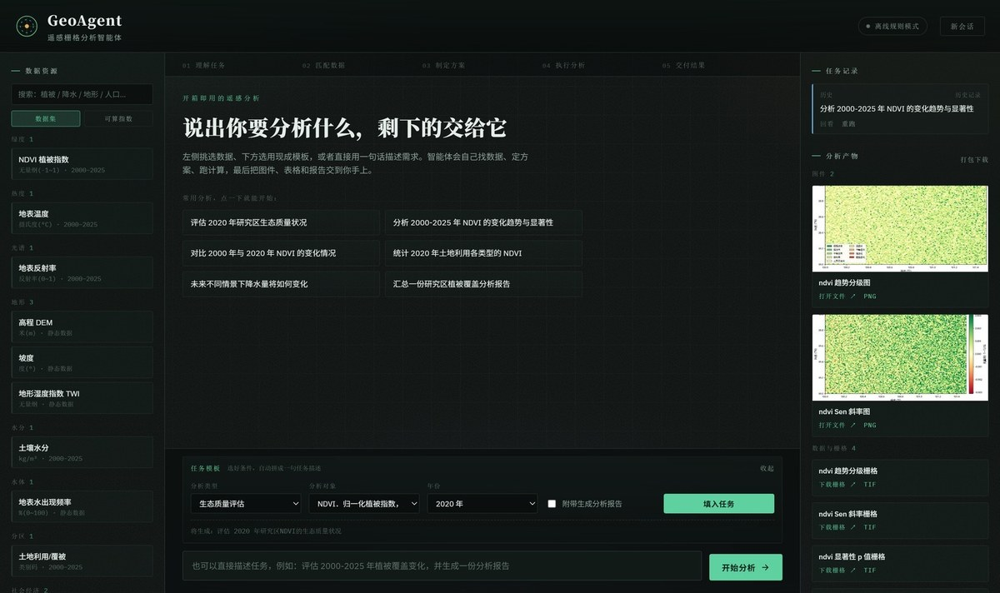
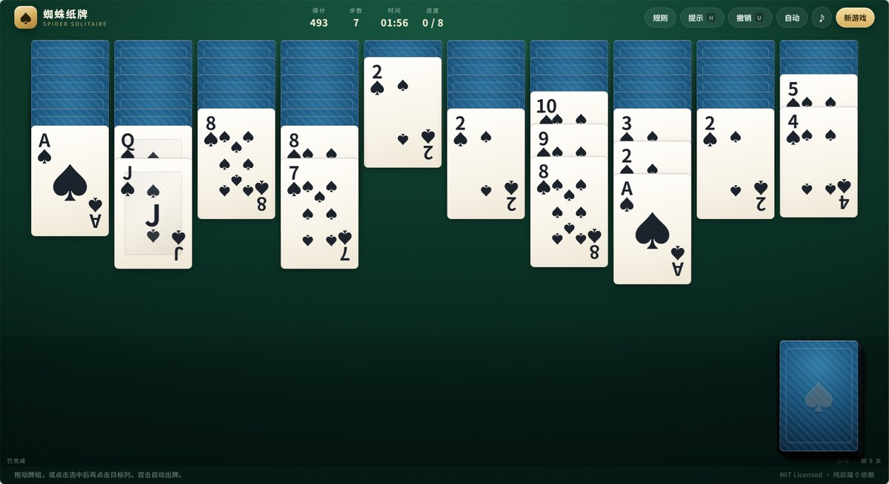

  

  

  
  
  
  

  

### 🌈 About · 关于我

- 🛰 **正在构建** — **GeoAgent**：把遥感分析从「写脚本」变成「说一句话」
- 🃏 **也在做** — 一个零依赖的纯前端纸牌游戏，顺手把前端基本功练一遍
- 🧠 **关注** — 智能体的任务规划与工具调度、栅格数据处理、可交互的 Web 界面
- 💡 **做事方式** — 先把东西做出来，再把它做好

  一个偏后端重计算（Python · 栅格数据 · LLM 编排），一个偏前端轻交互（原生 JS · 零依赖）——两边都在练。

### 🚀 Selected Work · 精选项目

#### 🛰 GeoAgent · 遥感栅格分析智能体

  

用一句自然语言下达遥感分析任务，智能体自主完成 **任务理解 → 记忆召回 → 自主规划 → ReAct 工具调用 → 结果交付**，并实时流式呈现每一步。

- **11 个**遥感分析工具，统一注册表 + OpenAI Function Calling 协议暴露
- **18 个**数据集定义，换研究区只需按目录约定放数据
- 未配置 LLM Key 时**自动降级**为离线规则模式，功能完整可用
- 附演示数据生成脚本：无真实数据也能一条命令跑通全链路

`Python` `FastAPI` `rasterio` `NumPy` `SciPy` `SSE`

  
  

#### 🕷 Spider Solitaire · 纯前端蜘蛛纸牌

  

**零依赖**的原生 JS 蜘蛛纸牌：单花色 / 双花色 / 四花色三档难度，带计分、计时、撤销、提示、自动收牌与音效。

- 手写牌局引擎（发牌、合法移动判定、自动完成判定），配套**单元测试**
- 不引任何框架与第三方库，断网也能玩
- GitHub Actions 自动部署到 GitHub Pages

`JavaScript` `HTML5` `CSS3` `GitHub Actions` `MIT`

  
  

### 🧰 Toolbox · 常用工具

  
  
  
  
  
  
  
  
  

### ✨ Now · 最近

- **2026.10** — 开源 **GeoAgent**：遥感栅格分析智能体，含 11 个工具与离线降级
- **2026.10** — **Spider Solitaire** 上线 GitHub Pages，可直接在线开局
- **2026.10** — 建立 GitHub 主页，开始记录做过的东西

---

<!--
  ═══════════════════════════════════════════════════════════════
  B 方案的动态统计卡片
  说明：目前 3 个仓库、提交数还少，统计卡片会显示接近全 0，反而扣分。
       等仓库和提交积累起来后，删掉这一整段的首尾注释标记即可启用。

  ⚠️ 网络实测（2026.10）：github-readme-stats.vercel.app 与
     github-profile-trophy.vercel.app 在本机网络下连接超时，
     启用前请改为自建实例或换成可达的镜像域名，否则会显示破图。
     已生效的 readme-typing-svg.demolab.com、img.shields.io、
     komarev.com 均实测可达；横幅、页脚与项目预览图都在本仓库内，永不破图。
  ═══════════════════════════════════════════════════════════════

  
  

-->

  

Thanks for stopping by · 欢迎通过邮件与我联系

